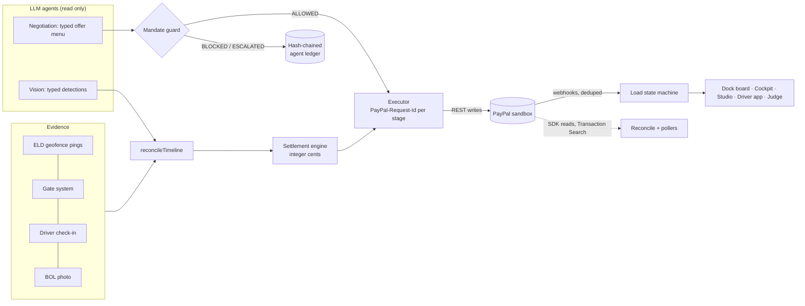

# DockClock

**A PayPal authorization hold is a spending mandate for an AI agent.**

Truck drivers wait at docks for hours without pay. DockClock places a PayPal hold when a load is dispatched, measures the wait from evidence (ELD geofence, gate system, driver check-in, BOL photo), and settles detention automatically: capture, payout to the driver at the gate, invoice for anything above the hold, and a defence pack if the charge is disputed.

The rule throughout: **the AI reads, code decides, PayPal executes.** No model output ever becomes a money amount. Agents pick from typed action menus, a mandate guard approves or blocks each one, and an executor makes the PayPal calls.

## The problem (verified figures only)
- ATRI 2024: drivers are detained at **39.3%** of stops (reefer **56.2%**). **94.5%** of fleets bill detention, but **fewer than half of invoices get paid**. Industry cost is about **$15B/yr**. Detained trucks drive **14.6% faster** afterwards.
- DOT OIG 2018: **$1.1–1.3B/yr** in lost driver income. Each 15 minutes of added dwell is *associated with* a **+6.2%** expected crash rate (a fleet-level association, not a causal claim).

## Try it
Hosted (PayPal sandbox): **https://dockclock-web.onrender.com/judge**. The free instance sleeps when idle, so the first request can take about a minute.

| Surface | Path | What it shows |
|---|---|---|
| Judge mode | `/judge` | Eight scenarios, each with its engine plan and the real sandbox calls (with `debug_id`), plus the red-team log and webhook arrivals |
| Dispatch | `/dispatch` | Create a load, size the hold, approve with PayPal, add evidence, settle or void |
| Dock board | `/dock` | Bryntum Scheduler: doors and trucks, colour = settlement state, break-even line, live via SSE, drag to re-price |
| Driver app | `/driver/<id>` | Installable mobile web app (EN/ES/HI/PA): wait clock, offers, parts purchase, Proof-of-Wait receipt |
| Cockpit | `/cockpit` | AG Grid Enterprise: ledger, review queue (the approve cell captures), agent ledger, reconciliation |
| Analytics | `/dashboard` | AG Studio with a custom facility quadrant widget and a natural-language analyst (free Gemini tier) |
| Verify | `/verify` | Checks a receipt against the hash-chained ledger |
| Health | `/health` | Queue depth, worker heartbeat, last cron reconcile, last webhook |

Ops pages ask for the ops key once (`/ops`). PayPal sandbox only: the app refuses to run against live.

## Architecture

The worker (pollers, reauth watchdog, offer expiry, evidence retry) runs inside the web service; a GitHub Actions schedule triggers ticks and the nightly reconcile.

## PayPal capabilities (all real sandbox calls)
| Capability | Used for |
|---|---|
| Orders v2 AUTHORIZE + vault | Dock-time hold; the payer approves once |
| Captures (partial, final, overcapture) | Settlement |
| Void | Nothing owed |
| Reauthorize | Hold older than the honor period |
| Payouts v1 | Driver paid at the gate; carrier credits |
| Invoicing v2 | Spillover above the hold; carrier liabilities |
| Disputes + provide-evidence | Automatic defence pack |
| Webhooks + signature verify | Source of truth for state changes (deduped, forward-only) |
| Orders v2 CAPTURE, carrier as payer | Priority slots and parts bought by the carrier agent |
| Transaction Search | Nightly reconciliation shown in the cockpit |

Money writes use REST with a stage-scoped `PayPal-Request-Id` on every call. Reads (orders, authorizations, captures) use the APIMatic-generated **PayPal Server SDK** (`@paypal/paypal-server-sdk`). Transaction Search stays on REST because the SDK does not cover it.

## AI, and exactly what it is allowed to do
- **Negotiation agents** (shipper treasury, facility, carrier): each picks an offer kind from a typed menu. The engine sets every price, and the mandate guard checks caps, counterparties, expiry and the hold ceiling. Text from another agent is display-only.
- **Vision** (gate camera, BOL photo): returns typed detections and events. A low-confidence result goes to human review, and injected text in a document cannot change a price.
- **Hold sizing** is statistical (dwell history quantiles), not an LLM.
- **Studio analyst**: answers questions over the ledger using read-only query tools.
- Models: Gemini free tier only, with per-call pacing, free-model rotation on rate limits and a daily spend cap. Over the cap, every agent falls back to its deterministic default.

## Sponsor tools
- **AG Grid Enterprise 36.3 + AG Charts 14.3**: the cockpit grids (grouping, pivot, master/detail, sparklines, the review cell that triggers a capture).
- **AG Studio 3.1**: the analytics dashboard, a custom widget and the AI analyst.
- **Bryntum Scheduler 8.0, Community tier** (free, no licence key): the dock board.
- **Channel3**: product search for the missing strap.
- **Render**: Blueprint in `render.yaml`.
- **APIMatic**: the PayPal Server SDK for read paths.

## Run it locally
```bash
docker compose up --build
```
This starts Postgres and the app on http://localhost:3000, runs migrations and seeds synthetic data. Put PayPal sandbox keys in `.env` first (see `.env.example`).

Without Docker:
```bash
pnpm install
pnpm db:up && pnpm db:migrate && pnpm db:seed
pnpm dev
```
In a second terminal, run `pnpm worker`. Run `pnpm tunnel` if you want PayPal webhooks delivered locally.

API collection: `docs/postman/` (generated from the route files by `scripts/postman.ts`, 42 requests). Smoke run: `npx newman run docs/postman/dockclock.postman_collection.json -e docs/postman/dockclock.local.postman_environment.json --folder "Smoke (read-only, must be 2xx)"`.

Tests: `pnpm typecheck && pnpm test`. Sandbox integration and red-team tests run with `RUN_SANDBOX=1`.

## Deploying for free (and what we did not pay for)
Several pieces of the planned stack are paid. They were **not** used, and free alternatives do the same job:

| Planned (paid) | Used instead (free) |
|---|---|
| Render paid web instance (no cold start) | Render free web service. It sleeps after 15 minutes idle; the 10-minute cron ping keeps it awake while judging |
| Render Background Worker | The same worker jobs run inside the web service (`apps/web/instrumentation.ts`, `RUN_WORKER_IN_WEB=1`) |
| Render Cron Job | GitHub Actions schedule (`.github/workflows/cron.yml`) calling `/api/cron/tick` and `/api/cron/reconcile` with the ops key |
| Render Postgres (free tier expires after 30 days) | Neon free Postgres |
| Paid Gemini API | Gemini free tier with pacing and model rotation |
| Bryntum commercial licence | Bryntum Community tier |

The paid worker and cron remain in `render.yaml` as comments for anyone who wants to upgrade.

## Reauthorization window
PayPal honours an authorization for 3 days and allows reauthorization within the 29-day validity. The six-day-delay scenario runs on the simulated clock in judge mode. `pnpm seed:reauth` seeds a real sandbox hold that exercises the live reauthorize call.

## Roadmap
PayPal Multiparty, with the carrier as payee of record (today DockClock is merchant of record in the sandbox); FMCSA carrier verification; real ELD integrations; facility appointment APIs; factoring-partner payouts; an EU version without overcapture.

## Licence
MIT. See `LICENSE`.
